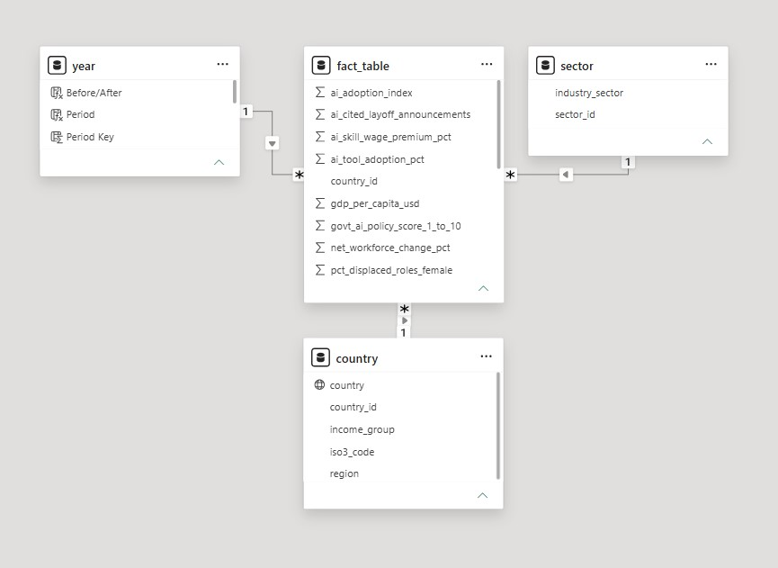
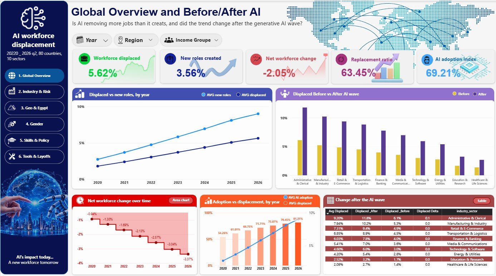
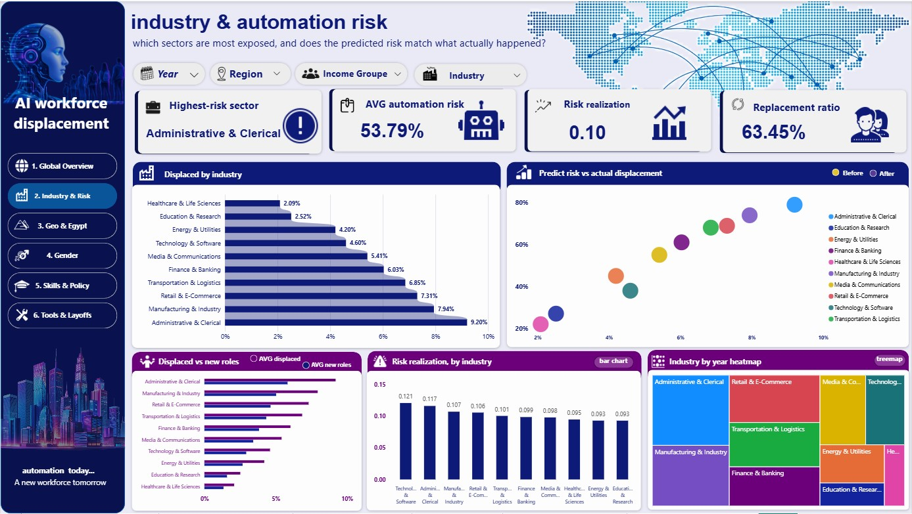
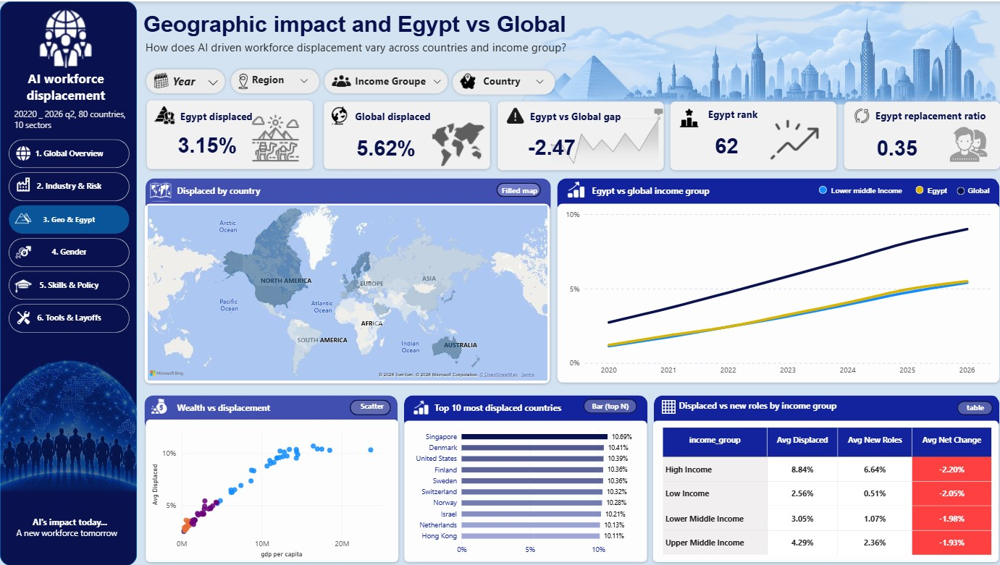
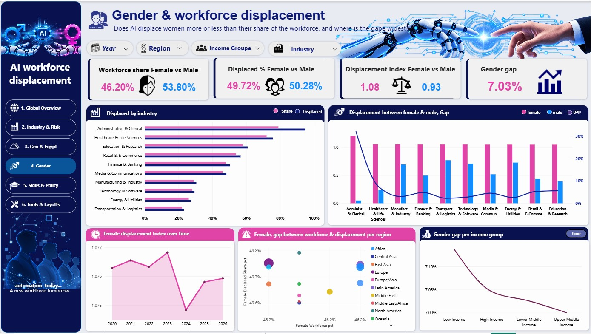
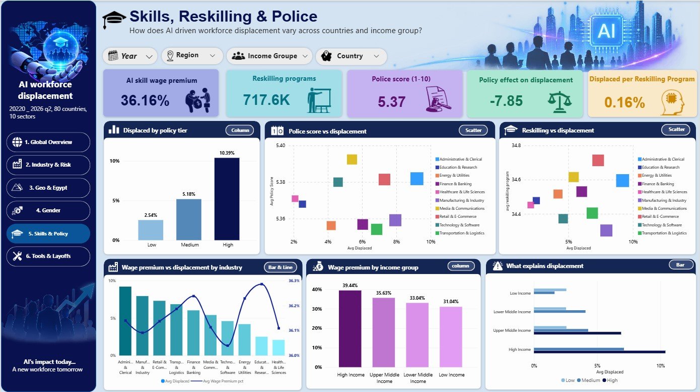
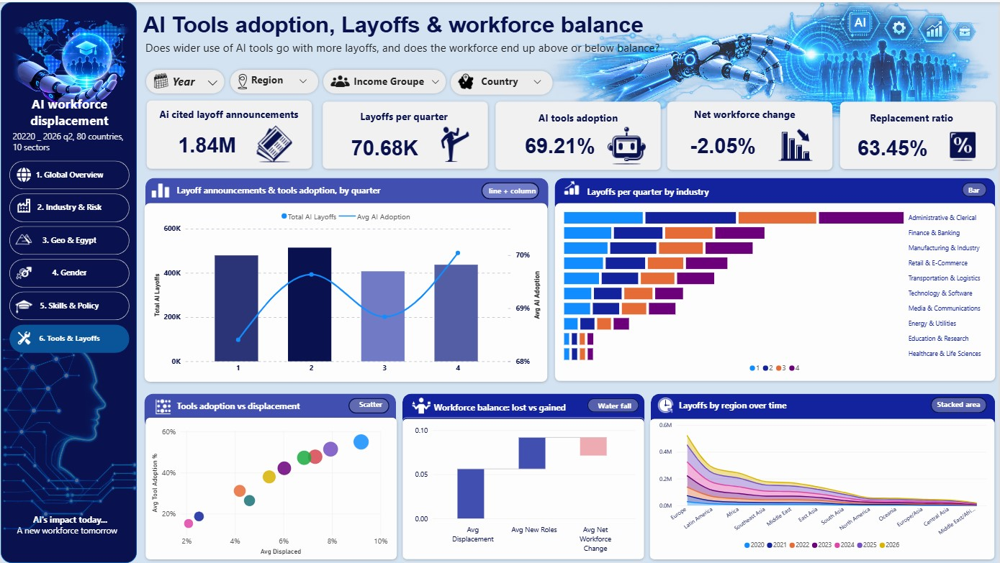

# 🤖 تحليل استبدال الذكاء الاصطناعي للعمالة (Power BI)

داشبورد تفاعلي من **6 صفحات** عملتها ب **Microsoft Power BI**، لتحليل كيف يعيد الذكاء الاصطناعي تشكيل سوق العمل العالمي بين عامي **2020 و2026**. لإظهار مهاراتي في تحليل البيانات، وكتابة DAX، وتصوير البيانات، وسرد القصة التحليلية.

## 🎯 هدف المشروع

الذكاء الاصطناعي يغيّر الوظائف الموجودة، والوظائف المعرضة للخطر، والمهارات المطلوبة. حوّل هذا المشروع بيانات سوق العمل الخام إلى قصة تفاعلية واضحة تساعد صانعي القرار على فهم **أين يحدث الاستبدال، ومن الأكثر تأثراً، وكيف يمكن الاستجابة**.

## ❓ الأسئلة التحليلية

- كيف تغيّرت القوى العاملة **قبل وبعد** تبنّي الذكاء الاصطناعي بين 2020 و2026؟
- ما **القطاعات** الأكثر عرضة لخطر الأتمتة؟
- كيف يختلف التأثير بين **المناطق الجغرافية**، وأين تقف **مصر مقارنةً بالمتوسط العالمي**؟
- كيف يختلف تأثر العمالة باختلاف **النوع (الجنس)**؟
- ما علاقة **المهارات وإعادة التأهيل والسياسات** بتحسّن النتائج؟
- كيف ترتبط **أدوات الذكاء الاصطناعي** بـ**التسريحات** وبالتوازن العام في سوق العمل؟

## 📂 البيانات

- **الاسم:** AI Workforce Displacement – Global (2020–2026)
- **الصيغة:** ملف Excel من 5 شيتات
- **الهيكل:**
  - **Main fact / Fact:** جداول الحقائق (مقاييس الاستبدال والذكاء الاصطناعي)
  - **Region:** البُعد الجغرافي
  - **Year:** البُعد الزمني
  - **Industry:** بُعد القطاعات

## 🛠️ الأدوات والمهارات

| الأداة | الاستخدام |
|--------|-----------|
| **Microsoft Excel** | مصدر البيانات والفحص الأولي |
| **Power Query** | تنظيف البيانات وتحويلها |
| **DAX** | المقاييس والمؤشرات المخصصة |
| **Power BI** | نمذجة البيانات والتصوير والتفاعلية |

## 📸 معاينة الداشبورد

## 🗂️ نموذج البيانات

يعتمد النموذج على **Star Schema**: جدول حقائق مركزي مرتبط بجداول الأبعاد (المنطقة، السنة، القطاع)، مما يجعل الفلترة سريعة والمقاييس نظيفة.

 

## 📊 صفحات الداشبورد

### 1️⃣ النظرة العامة وما قبل/بعد الذكاء الاصطناعي
 

نظرة شاملة على اتجاه القوى العاملة عالمياً من 2020 إلى 2026، مع مقارنة الفترة قبل تبنّي الذكاء الاصطناعي وبعده.

### 2️⃣ القطاعات وخطر الأتمتة
 

تفصيل لخطر الأتمتة والاستبدال عبر القطاعات لتحديد الأكثر عرضة.

### 3️⃣ التأثير الجغرافي ومصر مقابل العالم
 

مقارنة التأثير بين المناطق، ووضع مصر جنباً إلى جنب مع الصورة العالمية.

### 4️⃣ النوع (الجنس) واستبدال العمالة
 

دراسة كيف يؤثر الاستبدال على الفئات المختلفة من حيث النوع داخل سوق العمل.

### 5️⃣ المهارات وإعادة التأهيل والسياسات
 

استكشاف دور المهارات وبرامج إعادة التأهيل والسياسات في مواجهة التغيّر الذي يقوده الذكاء الاصطناعي.

### 6️⃣ تبنّي أدوات الذكاء الاصطناعي والتسريحات وتوازن العمالة
 

ربط تبنّي أدوات الذكاء الاصطناعي بالتسريحات وبالتوازن العام بين الوظائف المفقودة والمستحدثة.

## ✨ مميزات الداشبورد

- 6 صفحات موضوعية بتصميم موحّد وتنقّل واضح
- تنظيم ال measures في folders مختلفة حسب كل categore
- **Slicers** تفاعلية وفلترة متقاطعة بين العناصر المرئية
- مقاييس **DAX** مخصصة للمؤشرات والمقارنات
- تحليل مخصص لـ**مصر مقابل العالم**
- نموذج بيانات Star Schema

## 💡 أبرز النتائج

1. **الاتجاه العام:** تغيّرت القوى العاملة بنسبة **[-2.05%]** بين 2020 و2026، مع تحوّل واضح بعد تسارع تبنّي الذكاء الاصطناعي.
2. **القطاع الأكثر عرضة:** يسجّل قطاع **[Administrative & Clerical]** أعلى خطر أتمتة بنسبة **[79%]**.
3. **مصر مقابل العالم:** معدل الاستبدال في مصر **[3.15%]** مقابل **[5.62%]** عالمياً.
4. **فجوة النوع:** فئة **[النساء]** هي الأكثر تأثراً بنسبة **[1.08%]** مقابل **[0.93%]**.
5. **إعادة التأهيل:** **[818.5k reskilling programs count]**.
6. **[غيرها من النتائج]**.

## ✅ التوصيات

- **إعطاء أولوية لإعادة التأهيل** في القطاعات الأكثر عرضة، لأن البيانات توضّح أين يتركّز الخطر.
- **دعم الفئات المتأثرة** ببرامج موجّهة حيث يرتفع الاستبدال.
- **اعتماد سياسات داعمة** تربط تبنّي الذكاء الاصطناعي بخطط انتقال العمالة.
- **متابعة التوازن** بين الوظائف المفقودة والمستحدثة كمؤشر دائم.

## 👤 عني

**[مصطفى محمد]**
   محلل بيانات 

🔗 [LinkedIn](www.linkedin.com/in/mostafa-moham-ed)

